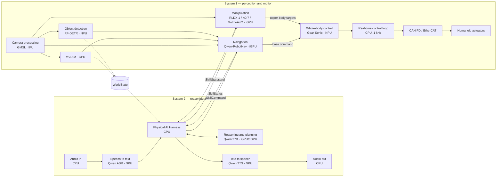
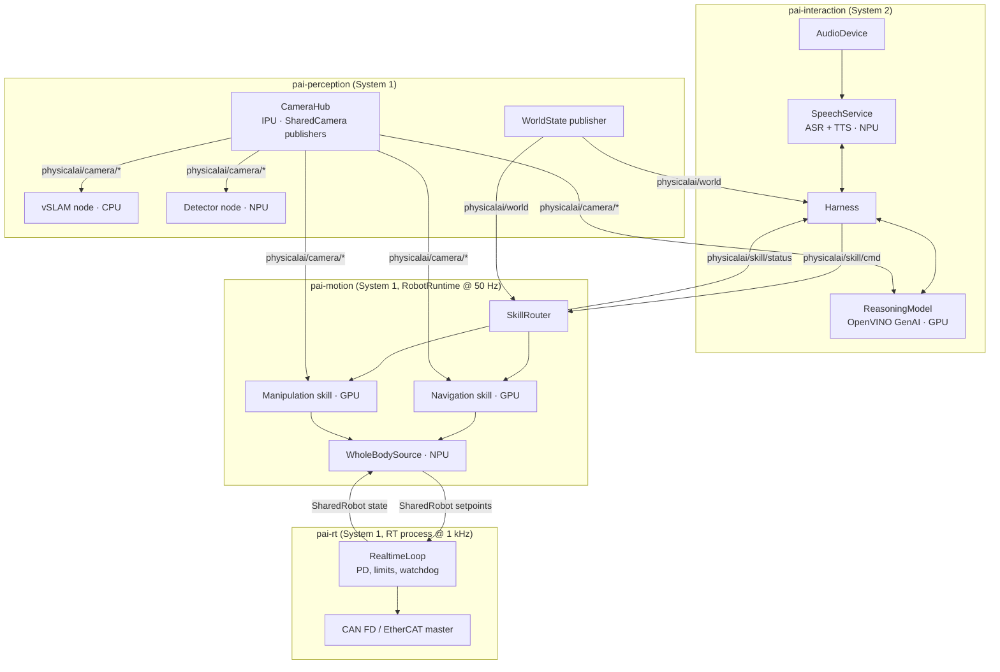

# Proposal: Dual-System (System 2 / System 1) Humanoid Runtime

| Field   | Value                                                         |
| ------- | ------------------------------------------------------------- |
| Status  | Draft                                                         |
| Scope   | `physicalai` runtime, new optional extras, new plugin package |
| Target  | Intel Core Ultra (CPU + iGPU + NPU + IPU), optional dGPU      |
| Breaks  | None — all changes are additive                               |

## 1. Summary

Today `RobotRuntime` runs **one** `ActionSource` against **one** `Robot` at a fixed
rate (default 30 Hz). That is the right shape for a single arm running one VLA, but a
humanoid needs a hierarchy of cooperating loops running at very different rates on
different accelerators:

- **System 2 — reasoning and interaction (slow, event-driven, 0.2–2 Hz):** speech in,
  a large reasoning/planning model, speech out, and a harness that turns intent into
  skill invocations.
- **System 1 — perception and motion (fast, 5 Hz → 1 kHz):** camera processing,
  navigation, manipulation VLAs, a learned whole-body controller (WBC) and a hard
  real-time joint control loop that drives CAN FD / EtherCAT.

This proposal extends the runtime with a small number of new, composable abstractions
so the humanoid compute architecture below can be expressed as configuration rather
than bespoke glue code, while preserving the existing design rules in
[Architecture](../explanation/architecture.md).

## 2. Target Architecture

| Block                     | Model / function                     | Size     | Device      | Rate (target)   | System |
| ------------------------- | ------------------------------------ | -------- | ----------- | --------------- | ------ |
| Audio in / out            | SoundWire, I2S, HD-A, DMIC           | —        | CPU         | stream          | 2      |
| Speech to text            | Qwen ASR                             | 0.6–1.7B | NPU         | per utterance   | 2      |
| Text to speech            | Qwen TTS                             | 0.6–1.7B | NPU         | per utterance   | 2      |
| Reasoning & planning      | Qwen3.8 (as labeled in source slide) | 27B      | iGPU / dGPU | event-driven    | 2      |
| Physical AI Harness       | agent loop, tool calling, memory     | —        | CPU         | event-driven    | 2      |
| Camera processing         | GMSL, 3–16 cameras                   | —        | IPU         | 30–60 fps       | 1      |
| vSLAM                     | visual SLAM                          | —        | CPU         | 15–30 Hz        | 1      |
| Object detection          | RF-DETR                              | small    | NPU         | 10–30 Hz        | 1      |
| Navigation                | Qwen-RobotNav                        | 4–8B     | iGPU        | 2–10 Hz         | 1      |
| Manipulation              | RLDX-1, π0.7 or MolmoAct2            | 4–8B     | iGPU        | 5–15 Hz chunked | 1      |
| Whole-body control        | Gear-Sonic                           | 42M      | NPU         | 50 Hz           | 1      |
| Real-time control loop    | PD / impedance, safety, watchdog     | —        | CPU (RT)    | 500 Hz – 1 kHz  | 1      |
| Fieldbus                  | CAN FD bus / EtherCAT                | —        | —           | 1 kHz           | 1      |



> The source slide connects manipulation directly to the real-time loop. This proposal
> routes both manipulation and navigation through the WBC so balance is always owned by
> one component; a "fixed-base" profile keeps the direct path for tabletop/bimanual
> robots (see §6.4).

## 3. What Exists Today

The proposal builds on these existing seams rather than replacing them:

| Existing piece                                      | Reuse                                                                  |
| --------------------------------------------------- | ---------------------------------------------------------------------- |
| `ActionSource` protocol (`runtime/action_sources`)  | Every System 1 skill and the WBC stage is an `ActionSource`.           |
| `PolicySource` + `set_task()`                       | Skill policies; System 2 retargets them by changing the task string.   |
| `SyncExecution` / `AsyncExecution` / `RTCExecution` | Per-skill choice of where/how inference runs; RTC for flow VLAs.       |
| `ChunkedActionQueue` + smoothers                    | Chunk blending for manipulation and navigation outputs.                |
| `ActionInterpolator`                                | Up-sampling between WBC rate and send rate.                            |
| `CompositeRobot`                                    | Named body groups (legs, waist, arms, hands, head) with joint prefixes. |
| `RobotObservation.sensor_data`                      | IMU, foot contacts, joint velocities/torques for the WBC.              |
| Runtime callbacks (`on_action_ready`)               | Safety transforms (limits, rate clamps) before send.                   |
| `SharedRobot` / `SharedCamera` (Zenoh)              | Cross-process fan-out of robot state and camera frames.                |
| `RemoteInferenceModel` (Zenoh)                      | Run heavy models in a separate process / host.                         |
| `InferenceModel` + `OpenVINOAdapter`                | CPU / GPU / NPU placement for every non-generative model.              |
| `@export_config` + jsonargparse                     | All new components are declared in YAML like existing ones.            |

Gaps: no generative LLM/VLM/ASR/TTS runtime, no notion of skills or skill status, no
structured multi-group body command, no world model, no hard real-time tier, no
cross-accelerator scheduling policy.

## 4. Design Principles

1. **Additive only.** `RobotRuntime`, `ActionSource`, `Robot` and `Camera` keep their
   current signatures. A single-arm `physicalai run` config keeps working unchanged.
2. **Rate tiers are processes, not threads.** Python cannot provide 1 kHz determinism,
   and a 27B decode must never share a GIL with a 50 Hz controller. Tiers communicate
   over the existing Zenoh transport (shared memory where same-host).
3. **System 2 never commands joints.** It emits typed `SkillCommand`s; only System 1
   produces actuator setpoints. This is the core safety boundary.
4. **Each tier degrades safely on its own.** If System 2 stalls, the active skill
   finishes or holds; if a VLA stalls, the WBC holds a stable stance; if the WBC stalls,
   the RT loop damps to a safe posture.
5. **Keep existing design rules.** Config stays passive; orchestrators execute;
   `RobotRuntime` does not own policy math; `InferenceModel` does not own timing.

## 5. Process Topology



| Process            | Owns                                   | Rate          | Failure behavior                       |
| ------------------ | -------------------------------------- | ------------- | -------------------------------------- |
| `pai-rt`           | fieldbus, joint PD, limits, e-stop     | 500 Hz–1 kHz  | setpoint timeout → damping → safe stop |
| `pai-motion`       | `RobotRuntime`, skills, WBC            | 50 Hz         | skill stall → WBC stance hold          |
| `pai-perception`   | cameras, vSLAM, detector, world state  | 15–60 Hz      | stale `WorldState` flagged by age      |
| `pai-interaction`  | audio, ASR/TTS, harness, reasoning     | event-driven  | harness timeout → skill keeps running  |

Each process is launched from its own YAML and can run under systemd, like
`physicalai robot serve` today. A thin `physicalai stack up --config humanoid.yaml`
launcher (Phase 3) may start all four from one file.

## 6. New Abstractions

All new types live under new subpackages; nothing in the current public API changes.

### 6.1 Messages (`physicalai.runtime.messages`)

Plain frozen dataclasses, msgpack-serialized with the existing `transport._codec`.

```python
@dataclass(frozen=True)
class SkillCommand:
    command_id: str                      # correlates status updates
    skill: str                           # "navigate", "manipulate", "stand", "stop", ...
    instruction: str | None = None       # language goal fed to the VLA (`TASK`)
    args: Mapping[str, Any] = field(default_factory=dict)  # e.g. {"goal": "kitchen"}
    timeout_s: float | None = None
    preempt: bool = True                 # replace the active skill on this body group

@dataclass(frozen=True)
class SkillStatus:
    command_id: str
    state: Literal["accepted", "running", "succeeded", "failed", "preempted", "timeout"]
    progress: float | None = None
    detail: str = ""

@dataclass(frozen=True)
class BodyCommand:
    """Structured System 1 output consumed by the WBC."""
    timestamp: float
    base_velocity: np.ndarray | None = None   # (vx, vy, wz) in body frame
    base_height: float | None = None
    torso: np.ndarray | None = None
    arms: Mapping[str, np.ndarray] = field(default_factory=dict)   # "left"/"right" -> joints or EE pose
    hands: Mapping[str, np.ndarray] = field(default_factory=dict)
    head: np.ndarray | None = None

@dataclass(frozen=True)
class WorldState:
    timestamp: float
    base_pose: np.ndarray | None              # from vSLAM, map frame
    detections: Sequence[Detection]           # from RF-DETR, camera + 3D if available
    map_version: int | None = None
```

### 6.2 `Skill` protocol (`physicalai.runtime.skills`)

A skill is an `ActionSource` that produces a `BodyCommand` fragment and reports status.
Existing `PolicySource` is wrapped, not modified.

```python
class Skill(Protocol):
    name: str
    body_groups: frozenset[str]          # e.g. {"base"} or {"left_arm", "right_arm", "hands"}

    def connect(self, *, bus: _CallbackBus, session_id: str) -> None: ...
    def start(self, command: SkillCommand) -> None: ...
    def step(self, obs: RobotObservation, frames: Mapping[str, Frame],
             world: WorldState | None, step: int) -> BodyCommand: ...
    def status(self) -> SkillStatus: ...
    def cancel(self) -> None: ...
    def disconnect(self) -> None: ...
```

Provided implementations:

- `PolicySkill(policy: PolicySource, body_groups, output_map, success: SuccessCriterion | None)`
  — calls `policy.set_task(command.instruction)`, maps the policy's flat action into the
  `BodyCommand` groups declared by `output_map`. Used for RLDX-1, π0.7, MolmoAct2.
- `NavigationSkill(policy: PolicySource, ...)` — maps Qwen-RobotNav waypoint/velocity
  output to `base_velocity`; success when goal reached in `WorldState.base_pose`.
- `ScriptedSkill` — stand, sit, hold, look-at, safe-stop; no model.

Success detection is pluggable (`SuccessCriterion`): pose tolerance, detector-based,
model-reported progress token, or timeout. Without it a skill only ends by timeout or
preemption — explicit and safe.

### 6.3 `SkillRouter` (`ActionSource`-compatible arbitration)

Receives `SkillCommand`s from a `CommandChannel`, owns the set of active skills, and
arbitrates per body group (one active skill per group; a navigation skill and a
manipulation skill may run concurrently on disjoint groups — "walk while carrying").

```python
@export_config(class_path="physicalai.runtime.SkillRouter")
class SkillRouter:
    def __init__(self, skills: Sequence[Skill], channel: CommandChannel,
                 default_skill: str = "stand", world: WorldStateSubscriber | None = None): ...
    def poll(self) -> None: ...                       # drain commands, start/preempt skills
    def step(self, obs, frames, step) -> BodyCommand: ...  # merge active skill outputs
```

`CommandChannel` has two implementations: `LocalCommandChannel` (in-process queue, for
tests and single-process sim) and `ZenohCommandChannel` (topics
`physicalai/skill/cmd` and `physicalai/skill/status`).

### 6.4 `WholeBodySource` (the `ActionSource` given to `RobotRuntime`)

This is where the hierarchy meets the existing runtime. `RobotRuntime` stays a single
loop with a single `ActionSource`; that source is the WBC wrapped around the router.

```python
@export_config(class_path="physicalai.runtime.WholeBodySource")
class WholeBodySource(ActionSource):
    def __init__(self, router: SkillRouter, controller: WholeBodyController,
                 joint_order: Sequence[str] | None = None): ...

    def update(self, robot_state, camera_frames, step) -> np.ndarray:
        self._router.poll()
        cmd = self._router.step(robot_state, camera_frames, step)  # BodyCommand
        return self._controller(robot_state, cmd)                  # full-body joint targets
```

`WholeBodyController` implementations:

- `LearnedWBC(model: InferenceModel, history: int, ...)` — Gear-Sonic on `device: NPU`,
  proprioception history + `BodyCommand` → joint position targets (+ optional gains).
- `PassthroughWBC` — fixed-base robots: concatenates arm/hand groups in `joint_order`.
  This keeps today's bimanual/tabletop robots on the same code path.

Running the WBC synchronously inside the 50 Hz tick is deliberate: a 42M model on the
NPU fits the budget, and it must observe fresh proprioception every tick. VLA skills
inside the router use `AsyncExecution` / `RTCExecution`, so their 100–300 ms latency
never blocks the tick — the router uses the latest chunk, smoothed by the existing
`ChunkedActionQueue`.

### 6.5 Real-time tier (`physicalai-rt` plugin package)

The 1 kHz loop is a separate package, because it needs native code and OS tuning
(`PREEMPT_RT`, `SCHED_FIFO`, isolated cores, locked memory) that the pure-Python
runtime must not require.

- Implemented in C++ (or Rust) with a minimal Python binding; exposes a `Robot` to
  `pai-motion` via the existing `SharedRobot` protocol over Zenoh/iceoryx2 shared memory.
- `send_action(targets, goal_time)` enqueues a timestamped setpoint; the RT loop
  interpolates between setpoints (cubic) and runs PD/impedance per joint.
- Owns all hard safety: position/velocity/torque limits, thermal limits, setpoint
  watchdog (e.g. > 3 WBC periods stale → damping mode), e-stop line, fall detection
  from IMU → controlled collapse.
- Fieldbus backends behind one interface: `SocketCanFD`, `EtherCATMaster`
  (e.g. SOEM/IgH), and `SimBackend` (MuJoCo) for SIL testing.

`RobotObservation.sensor_data` carries `imu.quat`, `imu.gyro`, `imu.acc`,
`joint.velocity`, `joint.effort`, `foot.contact`; `state` concatenates what the WBC's
manifest declares.

### 6.6 Perception tier (`physicalai.perception`)

- `CameraHub` — opens GMSL cameras (IPU via V4L2/libcamera on Linux) and republishes
  each as a `SharedCamera`, so N consumers read one capture. Adds a GMSL/IPU backend
  to `physicalai.capture` following the `add-camera-backend` skill.
- `PerceptionNode` protocol — `process(frames, obs) -> partial WorldState`, run at its
  own rate in its own thread/process. Implementations: `VSlamNode` (CPU),
  `DetectorNode(InferenceModel on NPU)`.
- `WorldStatePublisher` merges node outputs, stamps age, publishes on
  `physicalai/world`. Consumers must check age; skills treat stale world as "unknown".

### 6.7 Interaction tier (`physicalai.interaction`, extra `physicalai[interaction]`)

Generative models need a different API from `InferenceModel` (streaming decode,
KV-cache, tokenizer, chat templates), so they get their own thin layer on top of
OpenVINO GenAI instead of being forced through `InferenceModel`.

```python
class ReasoningModel(Protocol):
    def generate(self, messages: Sequence[ChatMessage], *, tools: Sequence[ToolSpec] = (),
                 images: Sequence[np.ndarray] = (), max_new_tokens: int = 512,
                 stream: Callable[[str], None] | None = None) -> ChatMessage: ...

class SpeechToText(Protocol):
    def transcribe(self, audio: np.ndarray, sample_rate: int) -> Utterance: ...

class TextToSpeech(Protocol):
    def synthesize(self, text: str) -> Iterator[np.ndarray]: ...   # streamed PCM chunks
```

Implementations: `OVGenAIReasoningModel(model_dir, device="GPU")` (LLM or VLM pipeline),
`OVQwenASR(device="NPU")`, `OVQwenTTS(device="NPU")`, plus `AudioDevice` (ALSA /
PortAudio; SoundWire, I2S, HD-A and DMIC are handled by the OS audio stack) with VAD.

#### Physical AI Harness

The harness is the System 2 orchestrator — an agent loop, not a model:

1. Inputs: `Utterance`s from ASR, `SkillStatus` updates, `WorldState` snapshots,
   optional keyframes from `SharedCamera`.
2. Builds a prompt with a bounded memory (dialogue + task history + current world
   summary) and a **tool schema generated from the registered skills**
   (`navigate(goal)`, `manipulate(instruction)`, `look_at(target)`, `say(text)`,
   `stop()`).
3. Validates every tool call against the schema and a policy allow-list before
   converting it to a `SkillCommand` — model output is untrusted input.
4. Re-plans on `failed` / `timeout` / new utterance; emits `say(...)` through TTS.
5. Exposes a deterministic `ScriptedPlanner` for tests and demos without the 27B model.

The harness is replaceable (`Planner` protocol), so teams can plug in their own agent
framework while keeping the skill/command contract.

## 7. Accelerator Placement and Scheduling

| Device  | Workloads                                     | Concern                                   |
| ------- | --------------------------------------------- | ----------------------------------------- |
| CPU     | harness, audio, vSLAM, RT loop, runtime ticks | isolate RT cores from everything else     |
| iGPU    | reasoning 27B, navigation VLA, manipulation VLA | **contention** — the main risk         |
| NPU     | ASR, TTS, RF-DETR, Gear-Sonic WBC             | WBC must not queue behind ASR/TTS         |
| IPU     | GMSL camera ISP                               | none from runtime side                    |
| dGPU    | optional: reasoning 27B                       | removes iGPU contention                   |

Proposed controls, all expressed as `adapter_kwargs` already forwarded to OpenVINO:

- **Priorities per model.** `MODEL_PRIORITY` / `GPU_QUEUE_PRIORITY` = `HIGH` for System 1
  models, `LOW` for the reasoning model. Same for the NPU: WBC `HIGH`, ASR/TTS `MEDIUM`.
- **Preemptible decode.** `OVGenAIReasoningModel` decodes in bounded token batches and
  yields, so a long generation cannot starve the iGPU for more than one batch.
- **Memory budget.** INT4 27B ≈ 14–16 GB, two INT4 4–8B VLAs ≈ 3–5 GB each, on shared
  system memory. A startup `DeviceBudget` check sums declared footprints from manifests
  and fails fast instead of OOM-ing mid-task.
- **Telemetry.** Every tier emits existing `InferenceEvent` / `MetricsEvent` with a
  `device` and `tier` tag so contention is visible in the existing Rerun/telemetry
  callbacks.

## 8. Configuration Example

```yaml
# pai-motion.yaml — consumed by the unchanged `physicalai run`
runtime:
  fps: 50
  robot:
    class_path: physicalai.robot.SharedRobot
    init_args: { name: humanoid-rt }          # served by pai-rt
  cameras:
    head:  { class_path: physicalai.capture.SharedCamera, init_args: { name: head } }
    wrist_l: { class_path: physicalai.capture.SharedCamera, init_args: { name: wrist_l } }
  action_source:
    class_path: physicalai.runtime.WholeBodySource
    init_args:
      controller:
        class_path: physicalai.runtime.wbc.LearnedWBC
        init_args:
          model:
            class_path: physicalai.inference.InferenceModel
            init_args: { export_dir: ./exports/gear-sonic, device: NPU, MODEL_PRIORITY: HIGH }
      router:
        class_path: physicalai.runtime.SkillRouter
        init_args:
          channel: { class_path: physicalai.runtime.ZenohCommandChannel }
          default_skill: stand
          skills:
            - class_path: physicalai.runtime.skills.NavigationSkill
              init_args:
                policy:
                  class_path: physicalai.runtime.PolicySource
                  init_args:
                    model: { class_path: physicalai.inference.InferenceModel,
                             init_args: { export_dir: ./exports/qwen-robotnav, device: GPU } }
                    execution: { class_path: physicalai.runtime.AsyncExecution }
            - class_path: physicalai.runtime.skills.PolicySkill
              init_args:
                name: manipulate
                body_groups: [left_arm, right_arm, hands]
                policy:
                  class_path: physicalai.runtime.PolicySource
                  init_args:
                    model: { class_path: physicalai.inference.InferenceModel,
                             init_args: { export_dir: ./exports/rldx1, device: GPU } }
                    execution: { class_path: physicalai.runtime.RTCExecution }
            - class_path: physicalai.runtime.skills.ScriptedSkill
              init_args: { name: stand }
  callbacks:
    - class_path: physicalai.runtime.callbacks.JointLimitClamp   # defense in depth; RT tier is authoritative
```

```yaml
# pai-interaction.yaml
harness:
  class_path: physicalai.interaction.Harness
  init_args:
    reasoning: { class_path: physicalai.interaction.OVGenAIReasoningModel,
                 init_args: { model_dir: ./models/qwen-27b-int4, device: GPU, priority: LOW } }
    asr: { class_path: physicalai.interaction.OVQwenASR, init_args: { device: NPU } }
    tts: { class_path: physicalai.interaction.OVQwenTTS, init_args: { device: NPU } }
    channel: { class_path: physicalai.runtime.ZenohCommandChannel }
    allowed_skills: [navigate, manipulate, look_at, stand, stop]
```

## 9. Safety Model

Layered, with the lowest layer authoritative:

1. **RT loop (`pai-rt`)** — hard limits, setpoint watchdog, e-stop, fall handling.
   Cannot be bypassed from Python.
2. **WBC** — produces only balanced, feasible whole-body targets; rejects
   `BodyCommand`s outside configured envelopes (base speed, reach).
3. **Runtime callbacks** — existing `on_action_ready` transforms for clamping and rate
   limiting.
4. **Skill router** — one owner per body group; `stop` is always accepted and preempts
   everything.
5. **Harness** — schema + allow-list validation of every LLM tool call; no free-form
   joint, velocity or code execution tools; speech-initiated commands can require
   confirmation for configured skills.

Transport security follows the existing remote-inference model: loopback by default,
explicit opt-in for remote, SSH tunnel recommended across hosts.

## 10. Phased Delivery

| Phase | Deliverable                                                                                       | Validates                       |
| ----- | ------------------------------------------------------------------------------------------------- | ------------------------------- |
| 0     | Messages, `Skill`, `PolicySkill`, `ScriptedSkill`, `SkillRouter`, `LocalCommandChannel`, `PassthroughWBC`, `WholeBodySource` | Hierarchy on existing SO-101 / bimanual + MuJoCo, no new hardware |
| 1     | `physicalai.interaction`: `ReasoningModel`, `Harness`, `ScriptedPlanner`, `ZenohCommandChannel`   | Language → skill → robot loop in sim |
| 2     | `LearnedWBC` (Gear-Sonic, NPU), MuJoCo humanoid profile, extended `sensor_data`                   | Standing / walking in sim at 50 Hz |
| 3     | `physicalai-rt` plugin (sim backend first, then CAN FD, then EtherCAT); `physicalai stack up`    | 1 kHz determinism, watchdog, SIL |
| 4     | `physicalai.perception`: GMSL/IPU backend, `CameraHub`, `DetectorNode`, `VSlamNode`, `NavigationSkill` | Walk-to-goal + manipulation |
| 5     | ASR / TTS on NPU, audio device, device priorities, `DeviceBudget`                                 | Full slide architecture on Core Ultra |

Each phase is independently mergeable and gated by tests (unit + MuJoCo SIL), in line
with `docs/development/coding-standards.md`.

## 11. Alternatives Considered

- **Make `RobotRuntime` multi-loop.** Rejected: mixes timing ownership with policy
  composition and breaks the "runtime does not own policy math" rule. Composition
  lives in `WholeBodySource` / `SkillRouter` instead.
- **Route LLMs through `InferenceModel`.** Rejected: generative decode, KV cache and
  streaming do not fit the single-forward `__call__` contract; forcing it would complicate
  every existing preprocessor/runner.
- **Adopt ROS 2 as the backbone.** Not required: the repo already standardizes on Zenoh,
  which interoperates with ROS 2 via `zenoh-bridge-ros2dds`. A ROS 2 bridge can be an
  optional plugin later.
- **Run the 1 kHz loop in Python.** Rejected: GC and GIL jitter make it unsafe on a
  floating-base robot.

## 12. Open Questions

1. WBC command interface: does Gear-Sonic consume joint targets, EE poses or motion
   tokens from the manipulation VLA? This decides `BodyCommand.arms` semantics.
2. Should manipulation VLAs on humanoids be trained to output upper-body joints only
   (WBC owns lower body), or whole-body actions with the WBC as a tracker?
3. NPU concurrency: can WBC + RF-DETR + ASR/TTS share the NPU within the WBC's 20 ms
   budget, or does the WBC need to fall back to CPU under load?
4. Skill success detection: model-emitted progress tokens vs. external criteria.
5. Single-host vs. split (e.g. RT on a dedicated real-time core/MCU); the `SharedRobot`
   boundary allows both, but latency budgets must be measured.
6. Reasoning model identity and VLM vs. LLM-only — the source slide lists "Qwen3.8 27B";
   confirm the exact checkpoint and whether it consumes camera keyframes directly.
